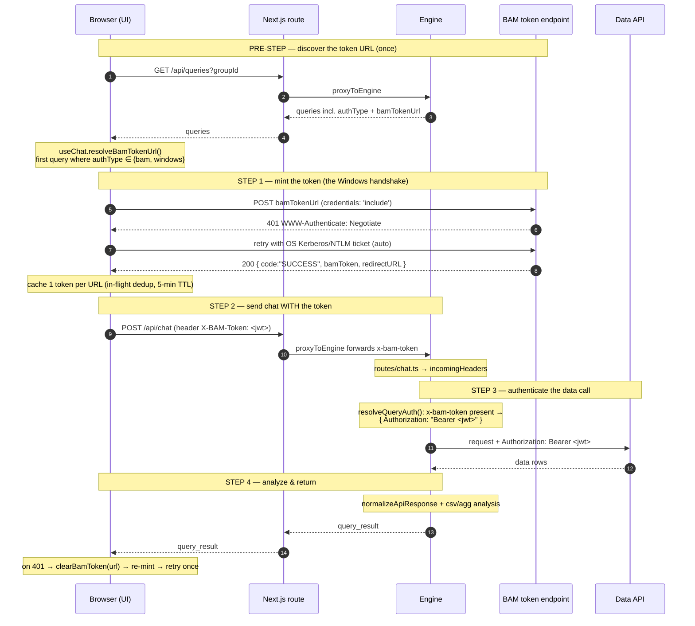

# Windows / BAM Authentication Flow

How the chatbot authenticates data-API calls that sit behind **Windows Integrated
Auth (NTLM/Kerberos)** or a **BAM token** endpoint.

## Why the token is minted in the browser

Windows Integrated Auth is a connection-bound handshake that uses the logged-in
user's identity via the OS (SSPI). Only the **browser**, talking **directly** to
the auth host, can complete it — a server-side proxy (Next.js or the engine) has
no Windows identity to present. So the browser mints a short-lived **bearer
token** once, and every downstream hop just carries that token.

`windows` and `bam` query types share the **same bridge**; they differ only in
the server-side _fallback_ used when the browser did not supply a token.

## Sequence



## bam vs windows — only the fallback differs

`resolveQueryAuth` (engine `query-service.ts`) treats both identically when the
browser supplies `x-bam-token`. They diverge only when it is **absent**:

```
resolveQueryAuth(query, incomingHeaders)
│
├─ x-bam-token present?  ──YES──►  { Authorization: `Bearer <token>` }   ← normal path (bam & windows)
│
└─ NO (fallback):
   ├─ authType 'bam'     →  fetchBamToken(query.bamTokenUrl) server-side → Bearer
   │                        (only works if the token URL is NOT Windows-gated,
   │                         e.g. a service account)
   └─ authType 'windows' →  forward the user's Authorization / Cookie headers
                            (legacy pass-through; real per-user IWA needs the
                             browser-minted token above)
```

## Token response shape

```json
{
  "code": "SUCCESS",
  "message": "SUCCESS",
  "bamToken": "<jwt>",
  "redirectURL": "<url>"
}
```

The `code` check is **case-insensitive** (`bam-auth.ts`) — real BAM returns
uppercase `"SUCCESS"`.

## Where each piece lives

| Step                   | Code                                                                         |
| ---------------------- | ---------------------------------------------------------------------------- |
| Discover `bamTokenUrl` | `src/hooks/useChat.ts` `resolveBamTokenUrl` ← engine `routes/queries.ts`     |
| Mint token (handshake) | `src/lib/bam-token.ts` `getBamToken(url)`                                    |
| Attach header          | `src/hooks/useChat.ts` → `X-BAM-Token` on `/api/chat`                        |
| Forward through proxy  | `src/app/api/chat/route.ts` → engine `routes/chat.ts`                        |
| Authenticate data call | `services/engine/src/core/api-connector/query-service.ts` `resolveQueryAuth` |
| Token validation       | `services/engine/src/core/api-connector/bam-auth.ts`                         |

## Environment prerequisites (not code)

1. The BAM host must be in the browser's **Local Intranet / Trusted Sites** zone
   (GPO or Chrome/Edge `AuthServerAllowlist`) so the OS auto-supplies the ticket.
2. BAM must allow the UI origin with credentials (CORS:
   `Access-Control-Allow-Credentials: true`, explicit origin — not `*`).
3. Configure a query with `authType: bam` (or `windows`) + a real `bamTokenUrl`
   via the admin UI.
